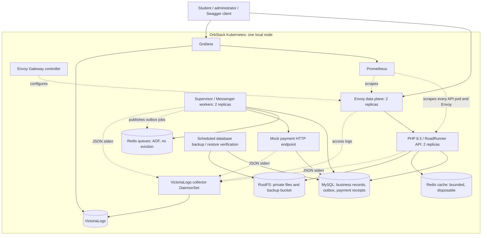

# Fault-Tolerant University Backend

Design specification, 2026-10-05. Status: written after approval of the architecture, domain defaults, payment interface, observability, and OrbStack deployment design; awaiting review of this written specification. Application implementation and experimental evaluation have not started.

## 1. Purpose and success criteria

Build a backend for a university course platform that demonstrates dependable operation and recovery under selected failures. Administrators manage courses, assignments, and grades and export student reports. Students enroll in free courses, purchase paid courses through a queued mock payment, and submit assignment files.

The implementation uses PHP 8.3, Symfony 7.4, API Platform, RoadRunner, Doctrine ORM, MySQL, Symfony Messenger, Supervisor, Redis, RustFS, Kubernetes, Helm, and an Envoy API gateway. Grafana displays RoadRunner metrics and application logs stored in VictoriaLogs.

The assignment requires a baseline and a resilient implementation, at least three independent services or modules, at least two infrastructure fault-tolerance mechanisms, at least four software mechanisms, controlled failure experiments, reliability calculations, and a demonstration of at least three failure/recovery scenarios. The implementation must supply evidence rather than claim that a diagram alone proves availability.

Success means:

- All authorized user and administrator flows work through a documented API.
- A payment can succeed immediately or on either of two retries; permanent declines and exhausted retries terminate correctly.
- Duplicate requests, queue redelivery, and an interrupted successful payment do not duplicate charges or enrollment in the resilient profile.
- A failed API instance is replaced while another replica continues serving requests.
- Pending purchases survive a temporary queue outage through durable database records and reconciliation.
- A database backup can be restored to a separate database and checked for consistency.
- Grafana starts with configured datasources and the RoadRunner and application-log dashboards.
- Baseline/resilient experiments produce raw data, explicit measurements, and a reproducible comparison.

Scope excludes a frontend, real card processing, refunds, instructor roles, timetable management, notifications, and automatic MySQL/Redis failover. The assignment's suggested timetable service is optional; its required independent-module count is met by the three modules below.

## 2. Approved approach and constraints

Use option A: one modular Symfony codebase, independently deployed HTTP API and worker processes, replicated API/gateway instances, durable storage, and tested backup recovery. Keep domain boundaries explicit so payments can fail or recover without embedding payment handling in course CRUD.

The three modules are:

1. **Courses and enrollment:** course lifecycle, pricing, free enrollment, and access checks. Depends on user identity and MySQL.
2. **Payments:** checkout, DTO validation, mock payment adapter, processing attempts, outbox publication, and recovery. Depends on MySQL, Redis queues, and the isolated mock payment HTTP endpoint.
3. **Academic records:** assignments, private submissions, grading, and course PDF reports. Depends on enrollment, MySQL, and RustFS.

The isolated mock endpoint wraps a concrete `MockPaymentService` class. The worker-facing `PaymentServiceInterface` receives payment details and a payment context. Its HTTP adapter forwards them to that endpoint. This preserves a replaceable interface while allowing actual HTTP timeout and service-outage experiments.

Deploy into the explicitly selected Kubernetes context `orbstack`. The current kubectl default points elsewhere; every deployment, inspection, and experiment command must pass `--context orbstack` or Helm's `--kube-context orbstack` explicitly. Keep baseline and resilient releases in separate namespaces, `midterm-baseline` and `midterm`, with observability in `midterm-monitoring` and the Envoy Gateway controller in `midterm-gateway`.

OrbStack's built-in cluster has one node. Two pods protect against process/pod failure but share that node and physical host. Prefer rather than require pod anti-affinity in the local values so both replicas can schedule. Supply topology-spread settings for a future multi-node deployment. Whole-node failure in OrbStack causes an outage; measure restart/recovery and identify this limitation explicitly. Local backups also share the Mac's physical failure domain and do not establish disaster recovery from loss of the host.

At design inspection, OrbStack and Docker were running, but the `orbstack` Kubernetes API refused connections at its configured local endpoint. Deployment includes starting OrbStack Kubernetes and checking node readiness; the design does not claim it has already been deployed.

## 3. Architecture

RoadRunner owns the PHP HTTP worker pool. Supervisor runs Messenger consumers, the outbox relay/reconciler, and the metrics exporter in separate worker pods. Kubernetes owns pod replacement. The HTTP API does not depend on worker availability to accept a purchase once its MySQL transaction commits.

Expose API/Swagger and Grafana with host-based Envoy routes: `midterm.k8s.orb.local` and `grafana.midterm.k8s.orb.local`. The baseline API uses `baseline.midterm.k8s.orb.local`. Verify the actual OrbStack LoadBalancer address and host routing during deployment. Document a local port-forward fallback. RustFS, Redis, MySQL, Prometheus, VictoriaLogs, mock payments, and RoadRunner RPC/metrics remain internal services.

## 4. Entity model and invariants

All primary IDs are integer IDs. Store timestamps in UTC; serialize ISO 8601 timestamps. Add indexes for foreign keys, checkout lookup, pending outbox messages, and due processing attempts. Doctrine migrations create the schema and database constraints.

### User

- `id`, `login` (unique, 3-64 characters), `username` (1-100 characters).
- `password_hash`, `is_admin` (default false), `created_at`.
- Use Symfony password hashing; hashes are never serialized in API output.
- Registration cannot set `is_admin`. Seed a demo administrator and students using explicit seed credentials documented for the local environment.

### Course

- `id`, `name` (1-255 characters), `price` (nullable integer), `created_at`, `updated_at`, `deleted_at`.
- Null or zero price means free; positive price means paid. Reject negative prices and values above the database integer limit.
- Prices use minor currency units. A single configurable `APP_CURRENCY` defaults to `USD`; changing it affects new checkout snapshots only.
- Price changes do not change a purchase already accepted.
- Reject course deletion with `409` while a purchase is active; this prevents a paid result from becoming impossible to enroll. Checkout, free enrollment, price changes, deletion, and settlement serialize access to the course row with a consistent user-then-course-then-purchase lock order where those rows are involved.

### CourseEnrollment

- `id`, `user_id`, `course_id`, `source` (`free` or `purchase`), nullable `purchase_id`, `created_at`.
- Unique `(user_id, course_id)`. Purchase enrollment is created only after confirmed payment success.
- Enrollment is the source of course access, rather than a pending purchase or client-supplied payment status.

### Assignment

- `id`, `name`, `course_id`, `created_at`, `deadline`, `description`, `updated_at`, `deleted_at`.
- Require a deadline later than creation; an update may close an assignment immediately by setting its deadline to the current time or later.
- A deleted course or assignment cannot receive new enrollment, checkout, submission, or grading mutations. Historical records remain available to authorized administrators.

### Submission

- `id`, `assignment_id`, `user_id`, `object_key`, `original_filename`, `content_type`, `size_bytes`, `sha256`, `submitted_at`.
- Unique `(assignment_id, user_id)` and one non-null object key: exactly one file per submission and one submission per student/assignment.
- Accept any format with a maximum actual file size of **10,000,000 bytes**. Empty files are allowed. The file has no executable role in the application.
- The student must be enrolled, and database acceptance must occur strictly before the assignment deadline. No replacement submissions in this scope.

### Grade

- `id`, `assignment_id`, `user_id`, `grade`, nullable `comment`, `created_at`, `updated_at`.
- Unique `(assignment_id, user_id)`; `grade` is an integer in `[0, 100]`.
- Require an existing submission for the same student and assignment. Deleting a grade removes that grade without deleting the submission.

### CoursePurchase

- `id`, `user_id`, `course_id`, `amount`, `currency`, `status`, `metadata`, `created_at`, `updated_at`, nullable `completed_at`, nullable `processing_lease_until`, `idempotency_key`, `request_fingerprint`.
- `metadata` is a JSON array of structured entries, not an arbitrary object. Store fixture ID, beneficiary name, provider reference, and sanitized outcome information; exclude card number, expiry, CVV, password, and tokens.
- States: `pending`, `processing`, `retry_wait`, `succeeded`, `declined`, `failed`.
- Preserve multiple historical purchases after a failed checkout, but permit only one active purchase per user/course. Serialize checkout and settlement with a transaction lock on the user row, then check active purchases and existing enrollment. Unique enrollment is the final database guard against duplicate activation.
- Require an `Idempotency-Key` header for checkout. Scope it to the authenticated user; save a canonical request fingerprint. Reuse returns the same purchase; a different payload with the same key returns `409`.
- A free-enrollment request also rejects an active purchase for that user/course, so changing the course price cannot race a pending payment into a conflicting access path.

### PaymentAttempt

- `id`, `purchase_id`, `attempt_number`, `status`, `started_at`, nullable `finished_at`, nullable `next_attempt_at`, nullable `provider_reference`, nullable `error_code`, `duration_ms`.
- Unique `(purchase_id, attempt_number)`; at most three distinct provider-processing attempts in the resilient profile.
- Record the attempt checkpoint before the provider call. A redelivery recovering the same attempt uses the same attempt identity.
- Connection recovery, an open circuit, or duplicate delivery must not start a fourth provider attempt.

### OutboxMessage

- `id`, `type`, `aggregate_id`, `payload`, `created_at`, `available_at`, nullable `published_at`, `lease_until`, `delivery_count`.
- Create the initial payment outbox record in the same transaction as the purchase. Messages contain IDs and a synthetic fixture reference, not raw card credentials.
- A published marker means Redis accepted the message, not that payment completed. Reconciliation examines unfinished purchase/attempt state and can republish a missing job safely.

### MockPaymentReceipt

- `id`, unique `purchase_id`, `provider_reference`, `amount`, `currency`, `created_at`.
- The mock provider persists a successful receipt before replying. A repeated purchase idempotency key returns the same successful receipt even after the worker crashes.
- Temporary outcomes are deterministic from the hard-coded fixture and stable attempt number and create no successful receipt. An already successful receipt takes precedence over a repeated fixture outcome.

### PaymentCircuitState

- One provider-scoped record with `consecutive_failures`, nullable `opened_until`, and nullable `probe_lease_until`.
- Store it in MySQL so worker replicas share circuit state. Five consecutive transient provider failures open the circuit for 15 seconds; permanent declines do not count. Allow one half-open probe with a bounded lease. Success resets the circuit; another transient failure reopens it.

## 5. Authentication and authorization

Use stateless JWT authentication. Public endpoints are registration, login, the active course catalogue, generated API documentation, and process liveness. Business mutations require authentication. Administrator authorization checks `is_admin`; students cannot grant themselves administrator access.

Students can see their own enrollments, purchases, attempts, submissions, and grades. Administrators can inspect these records for reporting and grading. Queries filter records server-side rather than relying only on client filters. Submission download is limited to its owner and administrators.

JWT claims do not decide enrollment or payment success. Resolve current user and access data from authoritative records before sensitive operations. Cache only the public course catalogue in the initial implementation.

## 6. API contract

Use JSON request/response DTOs and API Platform state providers/processors for domain operations. Configure generated OpenAPI and Swagger UI at `/api/docs`, with a machine-readable OpenAPI document and an export command. Document JWT bearer authentication, checkout idempotency, file upload limits, DTOs, and binary PDF/download responses. Explicitly allowlist exposed operations rather than generating unrestricted CRUD for every entity.

| Method and path | Access | Behavior |
| --- | --- | --- |
| `POST /api/register` | Public | Register regular user; `201` |
| `POST /api/login` | Public | Return JWT |
| `GET /api/me` | Authenticated | Current user summary |
| `GET /api/courses`, `GET /api/courses/{id}` | Public | Active catalogue |
| `POST /api/courses` | Admin | Create course; `201` |
| `PATCH /api/courses/{id}` | Admin | Update name/price |
| `DELETE /api/courses/{id}` | Admin | Soft-delete; `204` |
| `POST /api/courses/{id}/enroll` | Student | Enroll only if currently free; replay returns existing enrollment |
| `GET /api/enrollments` | Authenticated | Own records, or admin-filtered records |
| `POST /api/courses/{id}/purchase` | Student | Accept mock DTO and idempotency key; `202` with purchase/status link |
| `GET /api/purchases`, `GET /api/purchases/{id}` | Authenticated | Authorized status and sanitized attempts |
| `GET /api/courses/{id}/assignments` | Enrolled student/admin | Active assignment list |
| `POST /api/assignments` | Admin | Create assignment; `201` |
| `GET /api/assignments/{id}` | Enrolled student/admin | Assignment details |
| `PATCH /api/assignments/{id}` | Admin | Update assignment |
| `DELETE /api/assignments/{id}` | Admin | Soft-delete; `204` |
| `POST /api/assignments/{id}/submission` | Enrolled student | One multipart `file`; `201` |
| `GET /api/submissions`, `GET /api/submissions/{id}` | Authenticated | Authorized submission metadata |
| `GET /api/submissions/{id}/download` | Owner/admin | Stream original file as an attachment |
| `GET /api/grades`, `GET /api/grades/{id}` | Authenticated | Authorized grade data |
| `POST /api/grades` | Admin | Grade submitted work; `201` |
| `PATCH /api/grades/{id}` | Admin | Update grade/comment |
| `DELETE /api/grades/{id}` | Admin | Remove grade; `204` |
| `GET /api/courses/{id}/report.pdf` | Admin | PDF for all enrolled students and assignments |
| `GET /health/live`, `GET /health/ready` | Infrastructure | Process and database readiness checks |

Use pagination and bounded page size for collections. Return structured problem responses: `400` malformed requests, `401` unauthenticated, `403` unauthorized, `404` missing resources, `409` conflicting duplicate or invalid transition, `413` oversized payload, `422` field/domain validation, and `503` unavailable required dependencies. Expected mock declines are purchase outcomes, not gateway failures.

The report includes course name, generation time, student login/name, each assignment's submission status and grade/comment, and each student's average of recorded grades. Missing grades remain ungraded and are not converted to zero. Render an escaped Twig HTML template through Dompdf; the template uses local fonts/styles and no external resources. A report failure returns an error rather than a partial PDF presented as complete.

## 7. Payment DTO and hard-coded scenarios

The service contract is `PaymentServiceInterface::pay(PaymentDetailsDto $details, PaymentContext $context): PaymentResult`.

`PaymentDetailsDto` has four fields: `beneficiaryName`, `cardNumber`, `expiryDate` (`MM/YYYY`), and `cvv`.

`PaymentContext` contains purchase ID, snapshotted amount/currency, stable purchase idempotency key, and attempt number. `PaymentResult` contains a typed outcome, provider reference where applicable, and a sanitized error code. Clients cannot set amount, user ID, purchase status, attempt number, or scenario name.

The concrete mock class hard-codes the following synthetic fixtures. These are this application's own test rules and do not contact a card processor. Every fixture uses expiry `12/2035` and CVV `123`; beneficiary name is any non-empty validated name.

| Card number | Fixture | Attempt 1 | Attempt 2 | Attempt 3 |
| --- | --- | --- | --- | --- |
| `9900000000000010` | `success` | Success | Not needed | Not needed |
| `9900000000000028` | `retry_once` | Temporary failure | Success | Not needed |
| `9900000000000036` | `retry_twice` | Temporary failure | Temporary failure | Success |
| `9900000000000044` | `temporary_failure` | Temporary failure | Temporary failure | Temporary failure |
| `9900000000000051` | `declined` | Permanent decline | Not attempted | Not attempted |
| `9900000000000069` | `timeout` | Timeout | Timeout | Timeout |

Fixture details and outcome rules live in the mock service class; no environment flag or HTTP field chooses outcomes. Unknown card details, wrong expiry/CVV, missing fields, and malformed inputs are rejected before a purchase is accepted. Generate sample checkout payloads from this fixture catalogue so documentation and demo data cannot drift.

At checkout, resolve validated synthetic details to a fixture reference. Store that reference and beneficiary name, then discard raw card details. The queued worker reconstructs the exact synthetic DTO from the class's fixture catalogue and calls the service interface. Do not log checkout payloads or HTTP bodies on the internal mock route.

### Processing and recovery

1. Lock the user row; verify course price/access, idempotency, and absence of another active checkout. Atomically write purchase and initial outbox message, then return `202`.
2. The relay leases due outbox rows, publishes IDs to Redis, and marks publication. Lease expiry recovers a crashed publisher. Duplicate publication is allowed.
3. A consumer claims the purchase with a bounded lease. Terminal purchases are acknowledged without another provider call.
4. Persist or recover the current attempt checkpoint, then call the isolated mock endpoint using stable purchase/attempt identities.
5. On success, lock records in a consistent user-then-purchase order and atomically mark success and insert enrollment. Reuse the provider receipt if recovering after interruption.
6. On temporary failure or timeout, persist the attempt outcome and the next due time. The resilient profile allows two retries with approximately 1-second and 2-second backoff plus small jitter. After attempt 3, mark `failed`; a permanent decline marks `declined` immediately.
7. Reconciliation scans nonterminal purchases, expired leases, and due retries and republishes jobs missing from the broker. It never restarts a terminal failed/declined purchase automatically.

Messenger uses a retry limit of two and a Redis failed-message stream for delivery/handler infrastructure errors. Business outcomes are acknowledged after durable status, next due time, and a due outbox record have been saved; they do not also trigger a second, competing retry mechanism. Durable purchase/attempt records determine the provider-attempt ceiling independently of broker redelivery. Infrastructure errors before a provider call do not consume a provider attempt; failed infrastructure messages can be recovered by reconciliation once MySQL is available. Attempts and successful receipts survive queue data loss because MySQL is authoritative. Preserve a sanitized terminal failure audit record for declined/exhausted payments; manual broker redelivery cannot create a fourth attempt.

Use unique Redis consumer names derived from pod name and worker index. Set redelivery timeout above the maximum handler duration; reclaim abandoned messages. Do not trim a stream in a way that removes unacknowledged payment work.

## 8. File-storage consistency

Accept exactly one multipart part named `file`, measure actual size, compute checksum, and generate an opaque object key independent of the original filename. Gateway/PHP request limits include multipart overhead while the application enforces the exact file limit.

Write the private object to RustFS, then commit submission metadata after rechecking enrollment, deadline, and uniqueness. If the database write fails, attempt compensating object deletion. A scheduled cleanup removes sufficiently old objects confirmed to have no database reference; its age threshold must exceed maximum upload/request duration. No successful submission response is returned before both storage and database acceptance succeed.

Use authenticated API downloads with attachment disposition and a safe filename. Do not render uploaded content inline. RustFS outage returns a bounded `503` for uploads/downloads while unrelated course operations continue. Backups use a separate private bucket and credentials from student-file access.

## 9. Fault tolerance and failure model

Assume fail-stop application processes, temporary dependency/network failures, duplicate delivery, an interrupted transaction, queue loss, and overload. Do not claim Byzantine tolerance, geographically independent redundancy, RAID, or ECC from local container replication.

| Failure | Effect | Detection and resilient response |
| --- | --- | --- |
| API/worker crash | Interrupted requests or unacknowledged work | Kubernetes health/restarts, Supervisor restart, surviving API replica, queue redelivery and durable checkpoints |
| MySQL unavailable | Authoritative reads/writes and payment progress unavailable | Bounded connection/query timeouts, readiness removes affected API endpoints, `503`, recovery when database returns |
| Redis queue unavailable/lost | Processing paused or broker messages missing | Publisher error logs, pending-age monitoring, outbox and reconciliation recover work |
| Redis cache unavailable | Catalogue cache unusable | Bypass cache and query MySQL; isolate cache resources from queue Redis |
| Mock endpoint slow/unavailable | Delayed payment | HTTP timeout, bounded retries, circuit breaker, recorded attempts |
| Worker dies after provider success | Purchase may appear unfinished | Stable provider receipt and idempotent settlement recover without another charge |
| RustFS unavailable | File and backup operations fail | Storage timeout; no phantom submissions; other modules remain available |
| Node/host outage | Entire local deployment unavailable | Observe outage and restart recovery; no single-node continuity claim |
| High load | Queuing, rising latency, resource pressure | Envoy admission/rate limits, bounded worker pool, resource limits, measured degradation |

Infrastructure mechanisms demonstrated are (1) replicated application/gateway instances with load balancing and replacement and (2) backup infrastructure with verified restore. Persistent volumes support restart recovery but are not independent replicated storage. MySQL, queue Redis, and RustFS remain single-instance dependencies in option A.

Software mechanisms include exponential-backoff retries, timeouts, a payment circuit breaker, idempotency/duplicate detection, payment checkpoints, transactional rollback and outbox recovery, health checks, and cache degradation.

Default payment HTTP connection timeout is 1 second and total timeout is 2 seconds; the hard-coded timeout fixture delays beyond that bound. Set provider attempt leases to 30 seconds and broker redelivery timeout to 120 seconds. The relay/reconciler polls about once per second. An open payment circuit pauses provider attempts, logs the pause, and permits a bounded half-open probe after a cooldown; it does not convert all deferred purchases into declines.

Gateway routes use bounded request deadlines: allow longer deadlines for uploads and PDF reports than ordinary JSON requests. Any gateway retries are limited to safe reads; checkout/submission/grade writes are not automatically replayed by Envoy. Business retries belong to the payment processor.

Liveness checks process health independently of MySQL, Redis, and RustFS to avoid restart storms. API readiness checks database access. Queue/cache/storage failures remain operation-specific so they do not remove all otherwise useful API endpoints. Observability failures do not block business operations.

## 10. Baseline and resilient profiles

Use one codebase and the same business schema, fixtures, and workloads. Run profiles sequentially on the local cluster to avoid resource contention affecting comparisons. Retain logs/experiment datasets between runs.

| Capability | Baseline | Resilient |
| --- | --- | --- |
| API/gateway/worker replicas | One each | Two API/gateway/worker replicas |
| Queue processing | Redis asynchronous processing | Same transport plus recovery mechanisms |
| Provider processing attempts | One, no additional retry | Initial attempt plus two retries |
| Outbox/reconciliation | Direct dispatch after purchase commit; interrupted publication can leave pending work | Transactional outbox and pending-state reconciliation |
| Payment circuit breaker | Disabled | Enabled |
| Cache failure behavior | Surface dependency error | Bypass cache |
| Dependency timeouts | Longer bounded baseline deadlines | Short bounded operational deadlines |
| Advanced health/rollout controls | Minimal | Startup/readiness/liveness, graceful termination, disruption budgets |
| Backup procedure | Not automatically scheduled | Scheduled backups and tested restore |

Authentication, input validation, file limits, basic database transactions, and core uniqueness constraints remain in both. Baseline uses ordinary Kubernetes process replacement; it is a baseline without the selected advanced mechanisms, not a system stripped of every safety feature. Baseline-only configuration is explicitly labeled experimental.

Both profiles use the same mock provider contract and receipt behavior. Compare loss/recovery of accepted work, retry behavior, and availability; do not invent duplicate charges in the baseline when its retained integrity controls prevent them.

## 11. Logging and Grafana

### PHP logs

Inject `Psr\Log\LoggerInterface` throughout application services, backed by Monolog through Symfony's Monolog bundle. Use JSON formatting to `php://stderr` for API and worker processes. Supervisor forwards worker stdout/stderr to container streams without file rotation on those streams.

Log request ID, service, deployment profile, event, severity, purchase ID, attempt number, sanitized error code, outcome, and duration where relevant. Propagate request/correlation IDs into outbox jobs and mock calls. Do not log passwords, JWTs, CVVs, card numbers, or raw request bodies. Reset Monolog processors and application request state between long-lived RoadRunner requests and Messenger jobs; clear Doctrine state as required by the runtime integration.

### Collection and storage

Deploy single-node VictoriaLogs with a persistent volume and seven-day retention. Deploy the official VictoriaLogs collector as a DaemonSet to read Kubernetes container logs, attach namespace/pod/container metadata, and ship records to VictoriaLogs. Restrict collection to the midterm namespaces. Bound its disk buffering so a log-store outage cannot consume the node's entire disk.

Logs remain searchable after an individual application pod is replaced, subject to successful collection and retention. Logs not shipped before node loss can be lost; VictoriaLogs itself is not highly available in this profile.

### Metrics

Deploy one Prometheus instance with persistent storage and seven-day retention. Enable RoadRunner's metrics plugin on internal port 2112 and `http_metrics` middleware. Scrape each API pod directly rather than scrape a load-balanced service that randomly exposes one replica. Also scrape Envoy and the application/worker metrics exporter.

Expose application measures for pending purchase count/age, attempt outcomes, exhausted retries, outbox backlog, and dependency health. The worker exporter reads bounded authoritative aggregates or explicit counters; distinguish snapshots from cumulative event counters. Keep user IDs and purchase IDs in logs rather than high-cardinality metric labels.

### Grafana provisioning

Install Grafana with persistent storage, a Kubernetes Secret for its administrator credentials, the official VictoriaLogs datasource plugin, and provisioned Prometheus and VictoriaLogs datasources. Provision dashboards from versioned ConfigMaps/files rather than depend on manual imports.

Vendor RoadRunner's official HTTP dashboard from `roadrunner-server/docs`, commit `b89c02d11326e7fc66078da3d47910a2f3f1cb25`, path `lab/dashboards/http.md`. Extract its embedded JSON and record the source/license. Adapt the imported datasource variable to the provisioned Prometheus UID. Add pod/profile selection and correct rate/time units where necessary. Its panels cover uptime, Go memory, goroutines, worker state/memory, HTTP latency, request queue, and request rate.

Provide an application/payment dashboard with pending-age and retry outcomes, plus searchable logs. Grafana Explore supports filtering service, level, request ID, and purchase ID through the VictoriaLogs datasource. Correlate failure-injection timestamps with metrics and logs. Do not import RoadRunner Jobs panels as evidence for Symfony Messenger queues: these are different worker systems.

## 12. Local deployment and operations

Build a PHP 8.3 CLI image with required database, Redis, process-control, XML, and PDF-related extensions. Use RoadRunner for HTTP and the same application image with distinct entrypoints for Supervisor workers and the mock endpoint. Resolve compatible package releases into a Composer lockfile and pin deployment image/chart versions when implementing.

The application Helm chart owns API/workers/mock services, MySQL, separate queue/cache Redis, RustFS, secrets/configuration, migrations/seeding jobs, backup jobs, health checks, and Gateway API routes. A small observability release provisions Grafana, Prometheus, VictoriaLogs, and its collector. Install Envoy Gateway through its maintained Helm chart and create the required Gateway API resources. Avoid a second ingress controller.

Local setup must:

1. Verify PHP/Composer/Docker/kubectl/Helm and explicitly inspect the `orbstack` context.
2. Start OrbStack Kubernetes if stopped and wait for its node/storage provisioner to be ready.
3. Build a native-architecture application image with a non-`latest` tag. OrbStack Kubernetes shares the Docker image store; set `imagePullPolicy: IfNotPresent` for the local tag.
4. Install pinned Envoy and observability releases with the explicit context.
5. Install the application release with local values and generated local secrets; run migrations and idempotent fixture seeding as jobs.
6. Wait for workloads, verify API/Swagger/Grafana routes, and run API and payment smoke checks.
7. Demonstrate dashboard data and a searchable correlated API/payment log entry.

Use resource requests/limits appropriate for the local cluster. Graceful shutdown stops consumers accepting work, lets bounded active handlers finish, and releases leases after expiry if interrupted. Supervisor runs in the foreground and forwards termination to process groups. RoadRunner recycles workers by configured memory/request limits.

Back up MySQL every 15 minutes to the private backup bucket, retain seven days, and capture snapshot timestamp/checksum. Test restore into an isolated database without overwriting the active database. Measure achieved backup age, restoration duration, and record counts/invariants. Target recovery point is the latest successful backup; do not claim zero data loss for restoring a snapshot.

Deploying to the local cluster is authorized by the user. Failure-injection scripts guard the context and release namespaces, restore changed settings on exit, and refuse to affect unrelated workloads. Whole-cluster/node experiments require an explicit invocation and must account for other workloads discovered during deployment inspection.

## 13. Experimental methodology

Create a fixed seed dataset: administrator, students, free and paid courses, assignments with suitable deadlines, submissions/grades for PDF reporting, and sample request payloads for each hard-coded payment case. Use the same dataset and workload parameters for both profiles.

Each controlled run records UTC timestamps and monotonic durations, profile, image/config identity, experiment ID, injected fault and duration, detection time, recovery time, requests by status, logical operations recovered, and consistency outcome. Save machine-readable raw request samples and event logs under an experiment-specific directory; generate comparison summaries from those records. Run at least three repetitions per automated scenario to expose variation, and state the local resource settings.

| Experiment | Injection | Assertions and observations |
| --- | --- | --- |
| Application crash | Delete/terminate one API pod during probe workload | Surviving replica success, replacement timing, failed requests |
| Database failure | Temporarily stop the test release's MySQL workload, then restore it | Bounded errors, readiness, recovery, no partial enrollment/grade writes |
| Network/service timeout | Use timeout fixture or stop mock endpoint | Attempt counts, timeout bounds, circuit state, eventual terminal outcome |
| Interrupted transaction | Kill a payment worker after durable mock success but before settlement; separately interrupt outbox publication | Original receipt reused, single enrollment, pending purchase recovery |
| High load | Fixed concurrent catalogue and authenticated workloads | Throughput, latency, queue pressure, errors/rate limiting, recovery after load ends |
| Node outage | Explicitly stop/restart OrbStack Kubernetes while an external host-side probe records availability | Entire-cluster downtime, API startup and persistence recovery; local limitation |
| Queue/cache outage | Stop only the test queue or cache Redis workload, then restore it | Durable accepted purchases recover; cache fallback; no silent lost work |
| Backup recovery | Restore a known backup into an isolated database | Snapshot age, restore duration, checksums, counts, grade/enrollment invariants |

Use failure hooks only in the explicit local experiment profile; ordinary public APIs cannot terminate workers or alter infrastructure. A crash hook must occur at a verified processing checkpoint so the interrupted-payment experiment is repeatable.

Data-consistency checks include unique enrollments/submissions/grades; one successful mock receipt per purchase; a succeeded purchase corresponding to enrollment; no enrollment from declined/failed purchases; no provider attempt number above three; submission objects matching stored size/checksum; and report data matching authoritative grades.

## 14. Reliability calculations and interpretation

Define operational service failure using the same external probe and latency threshold in both profiles. A failed component is not necessarily an end-to-end service failure if another replica serves the request. Record injected component faults separately from observed service outages.

- **Request availability:** successful eligible probe requests divided by total eligible probe requests. Report timeouts and infrastructure/server failures separately from expected authorization, validation, decline, or rate-limit responses.
- **Time availability:** measured available time divided by the monitored observation window. State probe interval and its detection uncertainty.
- **MTTR:** total measured outage-to-restoration duration divided by the number of completed recoveries.
- **MTBF:** total observed operating/available time divided by observed service-failure count. Under this operating-time convention, an estimated cycle availability is `MTBF / (MTBF + MTTR)`; explain when it differs from directly observed availability.
- **MTTF:** mean time to the first service failure across repeatable fresh-start trials, with trials that never fail reported as censored rather than assigned an invented failure time.
- **Observed failure rate:** observed service failures divided by measured operating time, with units stated.
- **Detection time:** time from injection to the detector recognizing the fault.
- **Recovery time:** time from the defined outage/injection boundary to the first sustained successful recovery; state the boundary used.
- **Recovered operations:** unique accepted operations unfinished at injection that reach their intended terminal result after recovery; do not count repeated HTTP requests or duplicate deliveries as distinct recovered transactions.

When no service failures occur, report zero observed failures and that finite MTBF/MTTF cannot be estimated from that run. A short, deliberately injected local experiment measures recovery behavior and experimental availability; it is not a statistically established production failure rate or annual availability guarantee.

No experimental measurements exist at specification time. The final report will include only actual collected observations, raw-data references, and clearly distinguished theoretical examples. Preserve unsuccessful experiments and limitations instead of replacing them with simulated success figures.

## 15. Verification and deliverables

Meaningful automated checks cover domain constraints and role/ownership access, DTO validation and all mock scenarios, bounded attempts, idempotent checkout/settlement, concurrent checkout/enrollment, outbox replay, file-size boundaries and upload compensation, deadline checks, and PDF content.

Integration tests use MySQL, Redis, and RustFS where behavior depends on their semantics. Runtime smoke tests verify requests across long-lived RoadRunner workers do not retain another user's security/logger/Doctrine state. Queue tests verify unique consumer identities, abandoned-message reclamation, and graceful shutdown.

Validate Helm rendering and the deployment's health/routes; verify the provisioned Grafana dashboard queries return real series and logs. Check PDF rendering for readable layout and escaping. Perform the controlled experiments above and calculate summaries from the resulting datasets.

Deliver:

- Versioned source, Composer lockfile, Docker image build, migrations, and seed fixtures.
- Baseline and resilient Helm values, local setup and guarded experiment scripts.
- Generated OpenAPI/Swagger and reproducible mock request payloads.
- This `docs.md`, updated into the technical report, and `docs/architecture.mmd`.
- Raw experiment datasets/log references and measured comparison output.
- Database backup/restore evidence and at least three repeatable failure/recovery demos.

The final technical report follows the assignment's structure: introduction, requirements/assumptions, dependability model, reliability/failure analysis, architecture, infrastructure/software fault tolerance, implementation, methodology, results, discussion/limitations, conclusion, references, and an appendix with configuration/logs. This specification records the design portions; measured implementation/results will be added after execution.

## 16. Alternatives and limitations

Distributed RustFS (option B) and automatic MySQL/Redis failover (option C) were considered and not selected. They would strengthen stateful availability at the cost of more resources and deployment complexity.

The selected local deployment tolerates individual stateless process/pod failures and recovers queued work from authoritative records. It does not maintain availability when the single Kubernetes node, MySQL instance, or entire Mac fails. Backups recover a prior state and can lose newer transactions; Redis persistence alone does not guarantee every broker write survives host failure. Real payment-card processing would require a different provider/tokenization design rather than extending the synthetic fixture mechanism.

## 17. References

- Assignment source: `MIDTERM FTR.docx.pdf`, supplied by the user; requirements reviewed across all five pages.
- [Symfony 7.4 release and PHP requirements](https://symfony.com/releases/7.4).
- [API Platform OpenAPI support](https://api-platform.com/docs/core/openapi/).
- [Symfony Messenger retries, failure transport, Redis transport, and idempotency](https://symfony.com/doc/7.4/messenger.html).
- [Symfony logging and Monolog integration](https://symfony.com/doc/7.4/logging.html).
- [RoadRunner metrics and HTTP middleware](https://docs.roadrunner.dev/docs/logging-and-observability/metrics).
- [Pinned RoadRunner HTTP Grafana dashboard source](https://github.com/roadrunner-server/docs/blob/b89c02d11326e7fc66078da3d47910a2f3f1cb25/lab/dashboards/http.md).
- [Envoy Gateway traffic management](https://gateway.envoyproxy.io/docs/tasks/traffic/).
- [Kubernetes disruption and replication behavior](https://kubernetes.io/docs/concepts/workloads/pods/disruptions/).
- [Redis persistence](https://redis.io/docs/latest/management/persistence/).
- [RustFS Helm deployment modes](https://docs.rustfs.com/en/installation/cloud-native).
- [VictoriaLogs single-node Helm chart](https://docs.victoriametrics.com/helm/victoria-logs-single/).
- [VictoriaLogs collector Helm chart](https://docs.victoriametrics.com/helm/victoria-logs-collector/).
- [VictoriaLogs Grafana integration](https://docs.victoriametrics.com/victorialogs/integrations/grafana/).
- [OrbStack Kubernetes, local images, routing, and lifecycle commands](https://docs.orbstack.dev/kubernetes/).
